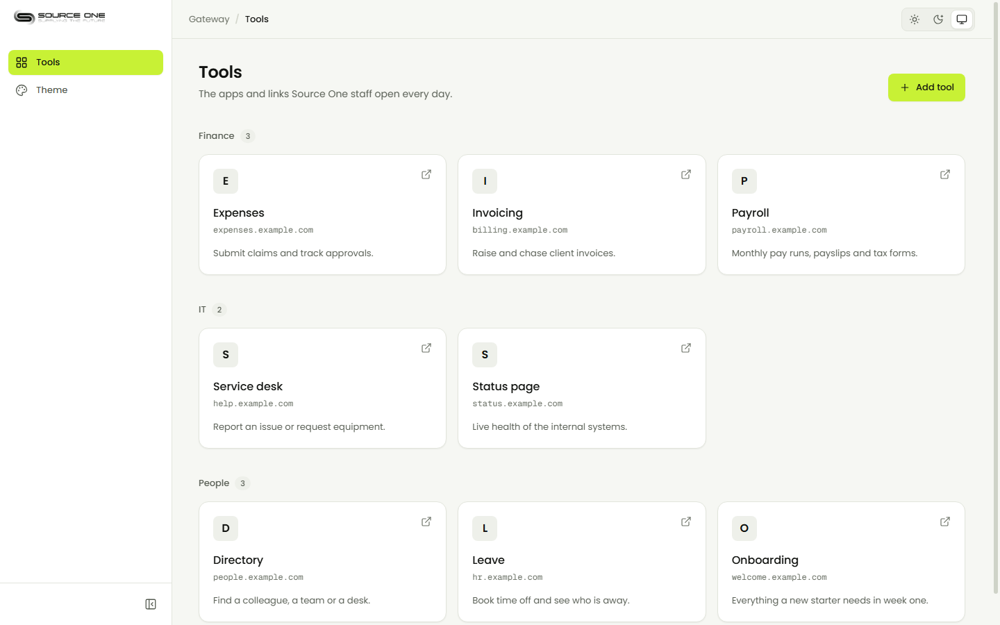
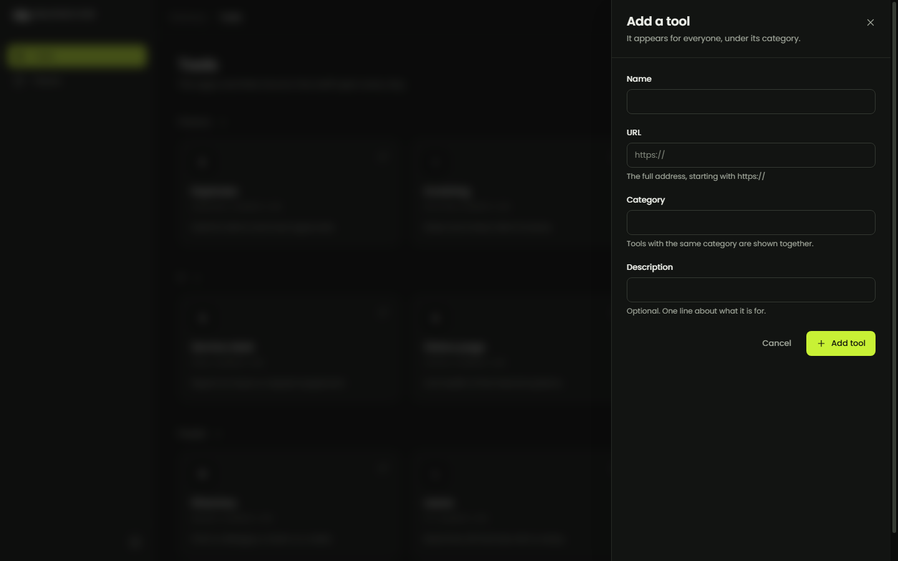
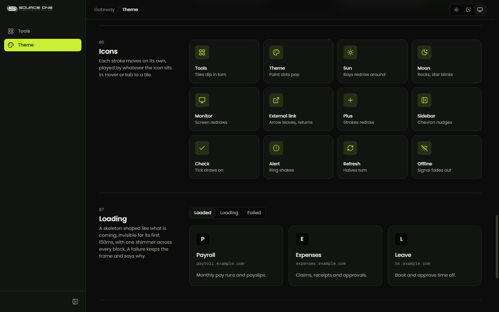
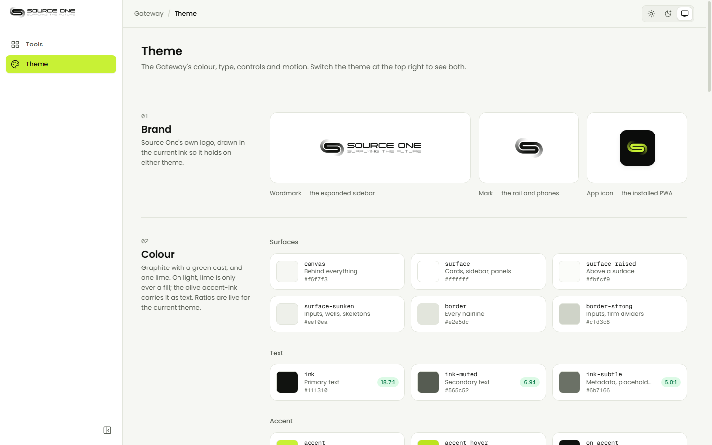
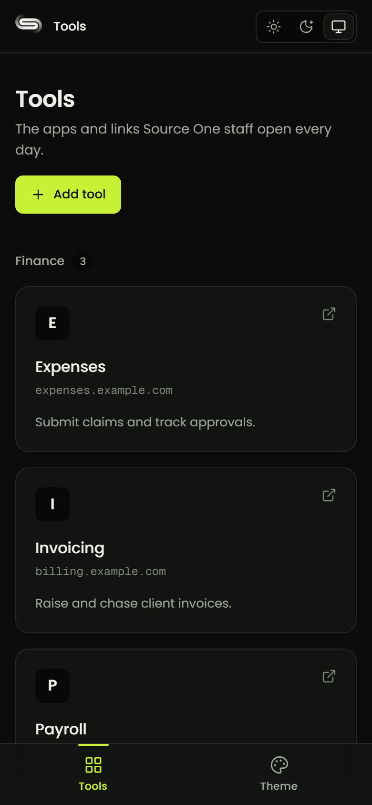
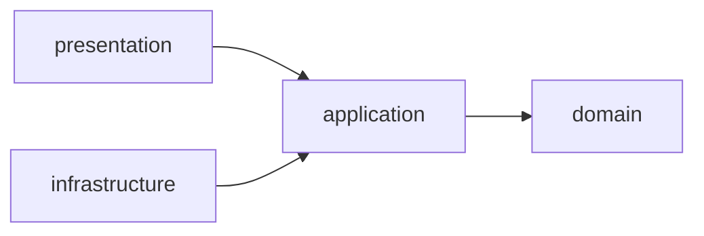

<div align="center">

<picture>
  <source media="(prefers-color-scheme: dark)" srcset=".github/readme/logo-dark.png">
  
</picture>

<h1>Gateway</h1>

<p><strong>The internal staff hub for Source One Global.</strong><br>
One place to reach the applications and links staff use every day.</p>

[](https://github.com/reyxdz/s1-gateway/actions/workflows/ci.yml)


<a href="#quick-start">Quick start</a> ·
<a href="#architecture">Architecture</a> ·
<a href="#documentation">Documentation</a> ·
<a href="#status">Status</a>

<br>

<picture>
  <source media="(prefers-color-scheme: dark)" srcset=".github/readme/tools-dark.png">
  
</picture>

<sub>Sample data. The page follows your device's light or dark setting, or the switch at the top right.</sub>

</div>

<br>

## What it is

Gateway is a small, fast web app that staff open to get to the tools they need:
payroll, leave, the service desk, anything with a link. Staff see the tools
grouped by category and open one in a click; anyone can add a new one, and it
appears for everyone.

It installs like an app on a laptop or phone, opens instantly from a cached
shell, and says plainly when it cannot reach the server. It never shows
yesterday's data as if it were today's.

## Highlights

- **Clean Architecture, enforced.** Every backend module and frontend feature
  is split into domain, application, infrastructure and presentation, and the
  dependency rule is a failing check in CI, not a convention
  ([ADR 0003](./docs/decisions/0003-clean-architecture-with-layers-inside-modules.md),
  [0004](./docs/decisions/0004-layer-rules-are-enforced-by-dependency-cruiser.md)).
- **One definition of every API shape.** Request and response types live in
  `backend/src/contracts/` and are imported by the frontend, so the two sides
  cannot drift apart silently
  ([ADR 0007](./docs/decisions/0007-one-definition-of-an-api-shape.md)).
- **An installable PWA that never caches your data.** The app shell is cached
  for an instant start; API responses never are
  ([ADR 0010](./docs/decisions/0010-the-app-shell-is-cached-api-responses-never-are.md)).
- **A design system with a showcase.** Light and dark themes built around Source
  One's lime, Poppins type, stroke-animated icons, page transitions, and
  skeletons shaped like the page they stand in for. All of it is on one screen
  at `/theme`
  ([`frontend/DESIGN.md`](./frontend/DESIGN.md)).
- **Tested against a real database.** Domain rules and use cases run with no
  database at all; repositories and the composed app run against real Postgres
  ([ADR 0008](./docs/decisions/0008-testing-strategy.md)).
- **Documented by purpose.** Getting started, guides, reference, explanation,
  decisions, plans and handoffs, each answering a different question.

## Screens

<table>
  <tr>
    <td width="50%" valign="top">
      <picture>
        
      </picture>
      <br><sub><b>Add a tool.</b> A side sheet over a blurred page; errors appear under the field they belong to.</sub>
    </td>
    <td width="50%" valign="top">
      <picture>
        
      </picture>
      <br><sub><b>The showcase.</b> Every icon animates stroke by stroke; the loading and error states can be triggered on demand.</sub>
    </td>
  </tr>
  <tr>
    <td width="50%" valign="top">
      <picture>
        
      </picture>
      <br><sub><b>Light, with the lime handled.</b> On light, the lime is only ever a fill; the olive <code>#466d00</code> carries it as text. Contrast ratios are computed live.</sub>
    </td>
    <td width="50%" valign="top" align="center">
      <picture>
        
      </picture>
      <br><sub><b>On a phone.</b> The sidebar becomes a bottom bar.</sub>
    </td>
  </tr>
</table>

## Quick start

You need Node 22 or 24, Docker Desktop and npm.

```bash
npm run setup        # env files, git hooks, dependencies for both services
npm run db:up        # Postgres 17 in Docker, on host port 5436
npm run db:migrate   # create the tables

npm run dev:api      # http://localhost:4000
npm run dev:web      # http://localhost:5173   (in a second terminal)
```

Open <http://localhost:5173>. The design system is at
<http://localhost:5173/theme>, and needs no database. The full walkthrough, with
troubleshooting, is in [Local setup](./docs/getting-started/local-setup.md).

| Command | What it does |
|---|---|
| `npm run typecheck` | TypeScript, both services |
| `npm run lint` | oxlint, failing on any warning |
| `npm run arch:check` | The dependency rule, both services |
| `npm run test:unit` | Every test that needs no database |
| `npm test` | Every test, including the database ones |
| `npm run docs:check` | Every docs link resolves; plan statuses are honest |

The full list is in [Commands](./docs/reference/commands.md).

## Architecture

Two services in one repository: a JSON API and a single-page app. Inside each,
code is organised by business module, and inside each module by layer.
Dependencies point inward only.



- **Domain** holds the rules and the ports they need. It imports nothing.
- **Application** holds one use case per operation, talking to the world only
  through ports.
- **Infrastructure** implements the ports: Drizzle repositories on the backend,
  HTTP gateways on the frontend.
- **Presentation** is the delivery mechanism: Express routes, React components.

Adapters meet use cases in one place per module, a composition root, by hand. There
is no DI container.

```
s1-gateway/
├── backend/             Express 5 API: modules/<name>/{domain,application,infrastructure,presentation}
├── frontend/            React 19 PWA: features/<name>/{…}, pages/, shared/ui, app/ (shell, routes)
├── docs/                Developer documentation: start at docs/README.md
├── scripts/             Repository tooling: docs checks, git hooks, screenshots
├── .githooks/           commit-msg (blocks AI attribution) and pre-push (fast checks)
└── docker-compose.yml   Postgres 17 for local development
```

| Layer | Choice |
|---|---|
| Database | PostgreSQL 17, Drizzle ORM with generated migrations |
| API | Express 5, TypeScript 6, zod, Pino |
| Web | React 19, Vite, Tailwind CSS 4, TanStack Query, React Router, `motion` |
| PWA | vite-plugin-pwa (Workbox) |
| Tests | Vitest, supertest, Testing Library |
| Checks | oxlint, dependency-cruiser |

## Documentation

Organised by purpose, not by feature. See [docs/README.md](./docs/README.md) for
the map.

| | |
|---|---|
| [Getting started](./docs/getting-started/) | Get it running |
| [Guides](./docs/guides/) | How to add a module, a use case, a page or a component |
| [Reference](./docs/reference/) | The API, data model, environment and commands |
| [Explanation](./docs/explanation/) | The architecture, and the constraints behind it |
| [Decisions](./docs/decisions/) | Why we chose what we chose: thirteen records so far |
| [Plans](./docs/plans/) | Step-by-step build plans with checklists |
| [Design system](./frontend/DESIGN.md) | Tokens, type, motion and the rules for using them |

New here? Read [Operating constraints](./docs/explanation/constraints.md), then
[Architecture](./docs/explanation/architecture.md).

## Status

**Built**

- [x] Health check, and the Tools list and create, with names unique ignoring case
- [x] An installable PWA: offline shell, update prompt, a kill switch
- [x] The design system: themes, shell, motion, icons, skeletons
- [x] CI: typecheck, lint, architecture, every test against Postgres, build, docs

**Not built yet**

- [ ] **Staff sign-in.** Nothing is access-controlled yet, so **do not expose
  this outside the internal network**
  ([constraints](./docs/explanation/constraints.md)).
- [ ] Deployment, and a release procedure

---

<sub>Internal to Source One Global. The screenshots above show sample data.</sub>
